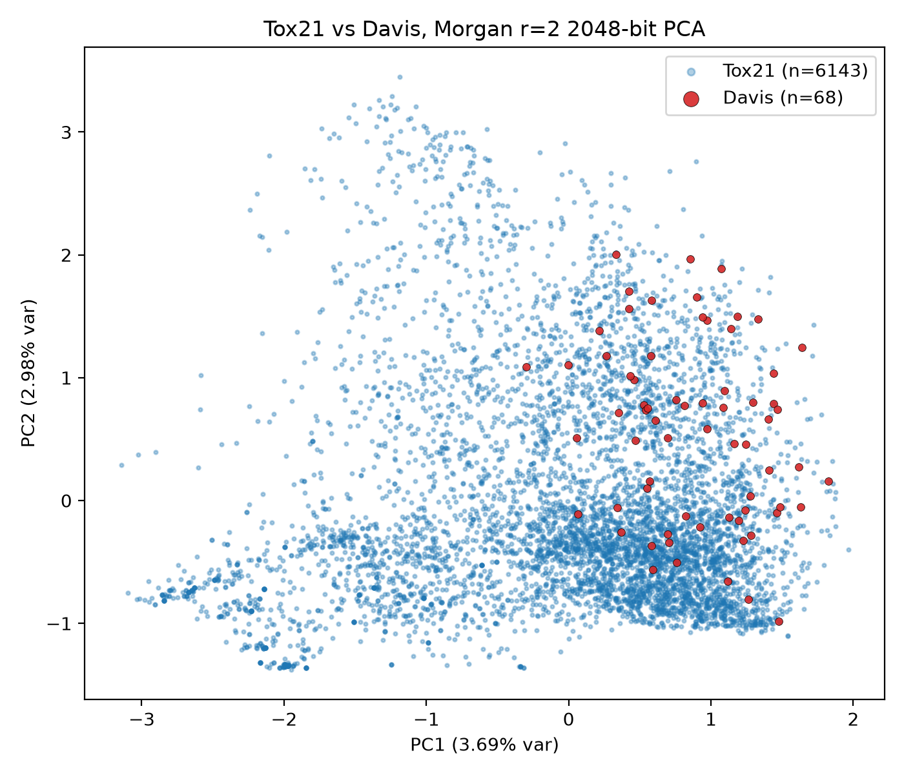
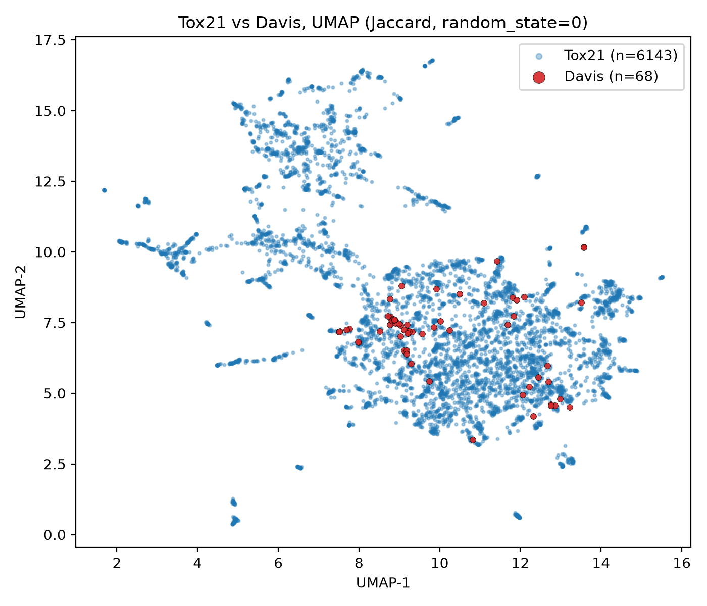

# Chemical-space overlap: Tox21 vs Davis

Generated by `src/10_chem_space.py`. Both sets standardized with the same `tox21lib.standardize` pipeline; fingerprints are Morgan r=2, 2048 bits; Tanimoto computed exactly (popcount algebra over all pairs).

## Dataset sizes

- Tox21 standardized molecules: 6143
- Davis distinct (drug_id, smiles) before standardization: 68
- Davis molecules after standardization: 68

Davis standardization stats:

| stat | value |
|---|---|
| input_rows | 68 |
| parse_failures | 0 |
| parse_failure_breakdown | {} |
| rows_before_dedup | 68 |
| unique_inchikeys | 68 |
| duplicate_rows_merged | 0 |
| label_cells_nan_from_tie | 0 |
| filtered_out | 0 |
| filter_breakdown | {} |
| final_molecules | 68 |

## Nearest-neighbour Tanimoto

| direction | n | min | p25 | median | p75 | max | frac_gt_0.4 | frac_gt_0.6 |
|---|---|---|---|---|---|---|---|---|
| tox21_to_davis | 6143 | 0.0253 | 0.1333 | 0.1667 | 0.2000 | 1.0000 | 0.0047 | 0.0036 |
| davis_to_tox21 | 68 | 0.1918 | 0.2832 | 0.3553 | 1.0000 | 1.0000 | 0.4706 | 0.3235 |

## Exact InChIKey overlap

Shared InChIKeys: 19

| inchikey | canonical_smiles |
|---|---|
| AAKJLRGGTJKAMG-UHFFFAOYSA-N | C#Cc1cccc(Nc2ncnc3cc(OCCOC)c(OCCOC)cc23)c1 |
| AXRCEOKUDYDWLF-UHFFFAOYSA-N | Cn1cc(C2=C(c3cn(C4CCN(Cc5ccccn5)CC4)c4ccccc34)C(=O)NC2=O)c2ccccc21 |
| BCFGMOOMADDAQU-UHFFFAOYSA-N | CS(=O)(=O)CCNCc1ccc(-c2ccc3ncnc(Nc4ccc(OCc5cccc(F)c5)c(Cl)c4)c3c2)o1 |
| BIIVYFLTOXDAOV-UHFFFAOYSA-N | CN1CCC(c2c(O)cc(O)c3c(=O)cc(-c4ccccc4Cl)oc23)C(O)C1 |
| CUIHSIWYWATEQL-UHFFFAOYSA-N | Cc1ccc(Nc2nccc(N(C)c3ccc4c(C)n(C)nc4c3)n2)cc1S(N)(=O)=O |
| CYOHGALHFOKKQC-UHFFFAOYSA-N | Cn1cnc2c(F)c(Nc3ccc(Br)cc3Cl)c(C(=O)NOCCO)cc21 |
| GFMMXOIFOQCCGU-UHFFFAOYSA-N | O=C(NOCC1CC1)c1ccc(F)c(F)c1Nc1ccc(I)cc1Cl |
| KTUFNOKKBVMGRW-UHFFFAOYSA-N | Cc1ccc(NC(=O)c2ccc(CN3CCN(C)CC3)cc2)cc1Nc1nccc(-c2cccnc2)n1 |
| MLDQJTXFUGDVEO-UHFFFAOYSA-N | CNC(=O)c1cc(Oc2ccc(NC(=O)Nc3ccc(Cl)c(C(F)(F)F)c3)cc2)ccn1 |
| MVCOAUNKQVWQHZ-UHFFFAOYSA-N | Cc1ccc(-n2nc(C(C)(C)C)cc2NC(=O)Nc2ccc(OCCN3CCOCC3)c3ccccc23)cc1 |
| OMZCMEYTWSXEPZ-UHFFFAOYSA-N | C=CC(=O)Nc1cc2c(Nc3ccc(F)c(Cl)c3)ncnc2cc1OCCCN1CCOCC1 |
| RITAVMQDGBJQJZ-UHFFFAOYSA-N | CNC(=O)c1ccccc1Sc1ccc2c(C=Cc3ccccn3)n[nH]c2c1 |
| UBPYILGKFZZVDX-UHFFFAOYSA-N | COc1cc(Nc2c(C#N)cnc3cc(OCCCN4CCN(C)CC4)c(OC)cc23)c(Cl)cc1Cl |
| UHTHHESEBZOYNR-UHFFFAOYSA-N | COc1cc2c(Nc3ccc(Br)cc3F)ncnc2cc1OCC1CCN(C)CC1 |
| UIARLYUEJFELEN-UHFFFAOYSA-N | CC12OC(CC1(O)CO)n1c3ccccc3c3c4c(c5c6ccccc6n2c5c31)CNC4=O |
| UXXQOJXBIDBUAC-UHFFFAOYSA-N | COc1cc2c(N3CCN(C(=O)Nc4ccc(OC(C)C)cc4)CC3)ncnc2cc1OCCCN1CCCCC1 |
| XGALLCVXEZPNRQ-UHFFFAOYSA-N | COc1cc2ncnc(Nc3ccc(F)c(Cl)c3)c2cc1OCCCN1CCOCC1 |
| YCOYDOIWSSHVCK-UHFFFAOYSA-N | Clc1ccc(Nc2nnc(Cc3ccncc3)c3ccccc23)cc1 |
| ZBNZXTGUTAYRHI-UHFFFAOYSA-N | Cc1nc(Nc2ncc(C(=O)Nc3c(C)cccc3Cl)s2)cc(N2CCN(CCO)CC2)n1 |

## Property distributions (two-sample KS)

| property | tox21_mean | tox21_std | davis_mean | davis_std | ks_statistic | ks_pvalue |
|---|---|---|---|---|---|---|
| mol_weight | 292.2 | 129.7 | 447 | 86.72 | 0.6255 | 6.348e-26 |
| clogp | 2.715 | 2.148 | 4.079 | 1.437 | 0.3988 | 3.703e-10 |
| tpsa | 60.49 | 45.64 | 87.66 | 20.66 | 0.5486 | 1.631e-19 |
| ring_count | 2.001 | 1.474 | 4.441 | 1.226 | 0.6798 | 2.75e-31 |
| aromatic_ring_count | 1.274 | 1.051 | 3.456 | 0.9373 | 0.7392 | 3.816e-38 |
| rotatable_bonds | 4.628 | 4.127 | 5.632 | 2.785 | 0.242 | 0.0005929 |
| fraction_csp3 | 0.4294 | 0.3037 | 0.2668 | 0.1376 | 0.3702 | 8.936e-09 |

## Projection

 — PCA (`random_state=0`), PC1 3.69% / PC2 2.98% explained variance.

 — umap-learn 0.5.12, metric=jaccard, random_state=0.

Verdict uses the median nearest-neighbour Tanimoto in the Tox21->Davis direction (each Tox21 molecule's max similarity to any Davis molecule): 0.1667. Thresholds: >0.4 strong, 0.25-0.4 weak, <0.25 negligible.

## Verdict: Negligible overlap

The shared-encoder experiment will likely show no gain for distributional reasons, and we need to decide whether to add bridging data or reframe the research question.
