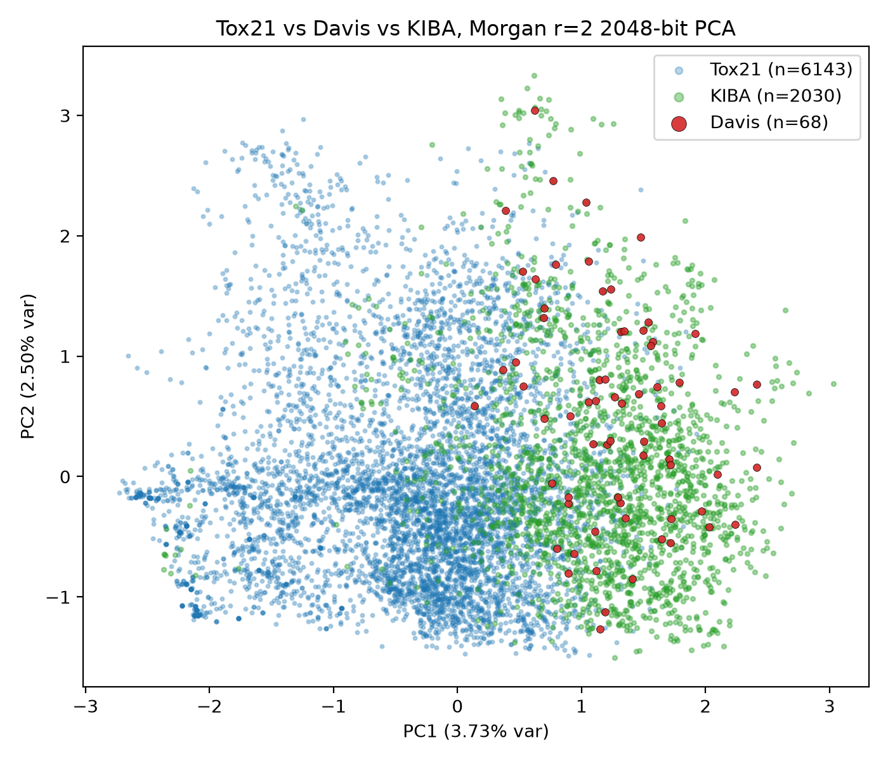

# Chemical-space overlap: Tox21 vs KIBA

Generated by `src/16_chem_space_kiba.py`, following the procedure of `src/10_chem_space.py` (same helpers). All sets standardized with the same `tox21lib.standardize` pipeline; fingerprints are Morgan r=2, 2048 bits; Tanimoto computed exactly (popcount algebra over all pairs). Within-set rows give each molecule's max similarity to any OTHER molecule of its own set (self excluded by index).

## Dataset sizes

- Tox21 standardized molecules: 6143
- KIBA distinct (drug_id, smiles) before standardization: 2068
- KIBA molecules after standardization: 2030
- Davis molecules after standardization (PCA only): 68

KIBA standardization stats:

| stat | value |
|---|---|
| input_rows | 2068 |
| parse_failures | 0 |
| parse_failure_breakdown | {} |
| rows_before_dedup | 2068 |
| unique_inchikeys | 2065 |
| duplicate_rows_merged | 3 |
| label_cells_nan_from_tie | 0 |
| filtered_out | 35 |
| filter_breakdown | {'too_many_heavy_atoms': 35} |
| final_molecules | 2030 |

## Nearest-neighbour Tanimoto (cross-set and within-set calibration)

| direction | n | min | p25 | median | p75 | max | frac_gt_0.4 | frac_gt_0.6 |
|---|---|---|---|---|---|---|---|---|
| tox21_to_kiba | 6143 | 0.0588 | 0.2151 | 0.2597 | 0.3103 | 1.0000 | 0.0653 | 0.0106 |
| kiba_to_tox21 | 2030 | 0.1538 | 0.2813 | 0.3230 | 0.3869 | 1.0000 | 0.2118 | 0.0325 |
| within_tox21 | 6143 | 0.1600 | 0.4653 | 0.6000 | 0.7097 | 1.0000 | 0.8452 | 0.4906 |
| within_kiba | 2030 | 0.1633 | 0.5200 | 0.7143 | 0.7971 | 1.0000 | 0.8404 | 0.6759 |

## Exact InChIKey overlap

Shared InChIKeys: 23

| inchikey | canonical_smiles |
|---|---|
| ACPOUJIDANTYHO-UHFFFAOYSA-N | O=C1c2ccccc2-c2n[nH]c3cccc1c23 |
| AFSDNFLWKVMVRB-UHFFFAOYSA-N | O=c1oc2c(O)c(O)cc3c(=O)oc4c(O)c(O)cc1c4c23 |
| AIFRHYZBTHREPW-UHFFFAOYSA-N | c1ccc2c(c1)[nH]c1cnccc12 |
| BIIVYFLTOXDAOV-UHFFFAOYSA-N | CN1CCC(c2c(O)cc(O)c3c(=O)cc(-c4ccccc4Cl)oc23)C(O)C1 |
| FBMQNRKSAWNXBT-UHFFFAOYSA-N | Nc1ccc(N)c2c1C(=O)c1ccccc1C2=O |
| GWEHVDNNLFDJLR-UHFFFAOYSA-N | O=C(Nc1ccccc1)Nc1ccccc1 |
| HBOMLICNUCNMMY-UHFFFAOYSA-N | Cc1cn(C2CC(N=[N+]=[N-])C(CO)O2)c(=O)[nH]c1=O |
| LDMWSLGGVTVJPG-UHFFFAOYSA-N | Cc1cc(-c2ccccc2)nnc1NCCN1CCOCC1 |
| MHFRGQHAERHWKZ-UHFFFAOYSA-N | CCCCCCCCCCCCCCCCCCOCC(COP(=O)([O-])OCC[N+](C)(C)C)OC |
| NGOGFTYYXHNFQH-UHFFFAOYSA-N | O=S(=O)(c1cccc2cnccc12)N1CCCNCC1 |
| OPXLLQIJSORQAM-UHFFFAOYSA-N | COC(=O)Nc1nc2ccc(C(=O)c3ccccc3)cc2[nH]1 |
| PFTAWBLQPZVEMU-UHFFFAOYSA-N | Oc1cc(O)c2c(c1)OC(c1ccc(O)c(O)c1)C(O)C2 |
| REFJWTPEDVJJIY-UHFFFAOYSA-N | O=c1c(O)c(-c2ccc(O)c(O)c2)oc2cc(O)cc(O)c12 |
| RITAVMQDGBJQJZ-UHFFFAOYSA-N | CNC(=O)c1ccccc1Sc1ccc2c(C=Cc3ccccn3)n[nH]c2c1 |
| RJMUSRYZPJIFPJ-UHFFFAOYSA-N | O=C(Nc1ccc([N+](=O)[O-])cc1Cl)c1cc(Cl)ccc1O |
| RYYVLZVUVIJVGH-UHFFFAOYSA-N | Cn1c(=O)c2c(ncn2C)n(C)c1=O |
| TZBJGXHYKVUXJN-UHFFFAOYSA-N | O=c1c(-c2ccc(O)cc2)coc2cc(O)cc(O)c12 |
| UHTHHESEBZOYNR-UHFFFAOYSA-N | COc1cc2c(Nc3ccc(Br)cc3F)ncnc2cc1OCC1CCN(C)CC1 |
| VTJXFTPMFYAJJU-UHFFFAOYSA-N | N#CC(C#N)=Cc1ccc(O)c(O)c1 |
| WUWDLXZGHZSWQZ-UHFFFAOYSA-N | Cc1cc(C)c(C=C2C(=O)Nc3ccccc32)[nH]1 |
| WVPSKSLAZQPAKQ-UHFFFAOYSA-N | NC1C2CN(c3nc4c(cc3F)c(=O)c(C(=O)O)cn4-c3ccc(F)cc3F)CC12 |
| XUBOMFCQGDBHNK-UHFFFAOYSA-N | COc1c(N2CCNC(C)C2)c(F)cc2c(=O)c(C(=O)O)cn(C3CC3)c12 |
| YCOYDOIWSSHVCK-UHFFFAOYSA-N | Clc1ccc(Nc2nnc(Cc3ccncc3)c3ccccc23)cc1 |

## Property distributions (two-sample KS)

| property | tox21_mean | tox21_std | kiba_mean | kiba_std | ks_statistic | ks_pvalue |
|---|---|---|---|---|---|---|
| mol_weight | 292.2 | 129.7 | 387.6 | 104.8 | 0.4131 | 2.79e-234 |
| clogp | 2.715 | 2.148 | 3.566 | 1.579 | 0.2395 | 2.407e-77 |
| tpsa | 60.49 | 45.64 | 89.89 | 41.22 | 0.4305 | 4.398e-255 |
| ring_count | 2.001 | 1.474 | 4.039 | 1.394 | 0.6098 | 2.94e-321 |
| aromatic_ring_count | 1.274 | 1.051 | 3.358 | 1.088 | 0.7064 | 1.591e-321 |
| rotatable_bonds | 4.628 | 4.127 | 4.327 | 2.926 | 0.0831 | 1.284e-09 |
| fraction_csp3 | 0.4294 | 0.3037 | 0.2025 | 0.1526 | 0.4177 | 9.874e-240 |

## Projection

 — PCA (`random_state=0`) over Tox21+Davis+KIBA, PC1 3.73% / PC2 2.50% explained variance.

Verdict uses the median nearest-neighbour Tanimoto in the Tox21->KIBA direction (each Tox21 molecule's max similarity to any KIBA molecule): 0.2597. Thresholds: >0.4 strong, 0.25-0.4 weak, <0.25 negligible.

## Verdict: Weak overlap

Shared encoder is defensible but we should expect modest gains and say so in the report.

The Davis-based conclusion (negligible overlap, Tox21->Davis median 0.1667) does NOT hold for KIBA: with 2030 drugs instead of 68, the Tox21->KIBA median is 0.2597. Calibration: the within-set nearest-neighbour medians are 0.6000 (Tox21) and 0.7143 (KIBA), so the cross-set median is 0.43x the within-Tox21 median. Because molecules in each set find much closer neighbours inside their own set than in the other, the low cross-set figure is not just the floor of the Morgan metric: the two sets occupy genuinely different regions of chemical space, not merely sparse fingerprints.
